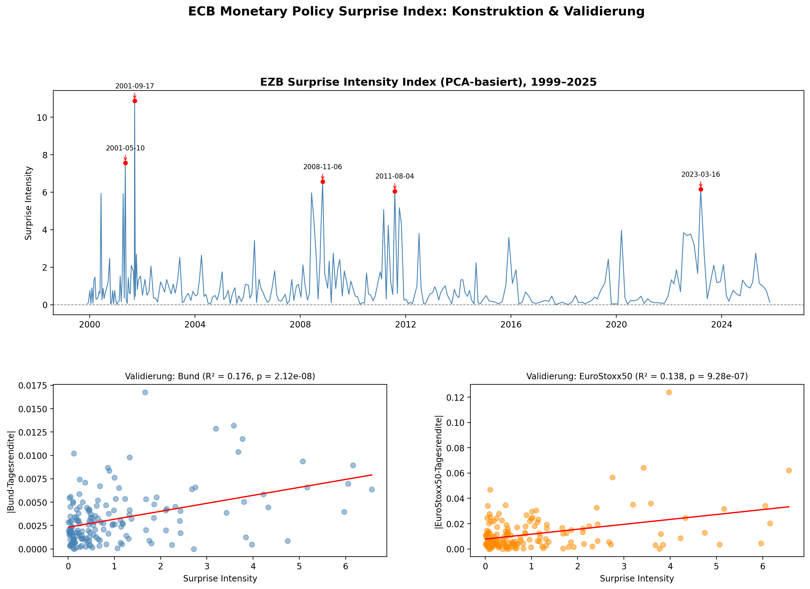

# ECB Surprise Index

A PCA-based index of ECB monetary policy surprises, built from intraday OIS yield data and validated against market returns.

## Motivation

Central bank announcements move markets to the extent that they contain *new* information. This project builds a quantitative "surprise index" from the policy rate's expected path (via OIS swap rates) and tests whether bigger surprises are associated with bigger same-day price reactions in rates and equity markets.

## Methodology

1. **Data**: Euro Area Monetary Policy Event-Study Database (EA-MPD, [Altavilla et al., 2019](https://doi.org/10.1016/j.jmoneco.2019.08.016)) — intraday OIS rate changes around ECB Governing Council meetings (1999–2025).
2. **PCA**: Standardize changes across 5 OIS maturities (1M–2Y) and run PCA. Component 1 (~80% of variance) is a **Level** factor (parallel curve shift); component 2 (~16%) is a **Slope** factor (curve steepening/flattening, consistent with Forward Guidance / Timing surprises, cf. [Gürkaynak, Sack & Swanson, 2005](https://www.ijcb.org/journal/ijcb05q2a1.pdf)).
3. **Index**: Variance-weighted combination of the absolute Level and Slope scores into a single `surprise_intensity_pca` series.
4. **Validation**: OLS regression of same-day absolute returns (German Bund ETF `EXHD.DE`, EuroStoxx50) on the surprise index, with HC3 robust standard errors.

## Results

| Market | Factor | R² | p-value |
|---|---|---|---|
| Bund (EXHD.DE) | Combined | 0.176 | 2.1e-08 |
| Bund (EXHD.DE) | Level | 0.166 | — |
| Bund (EXHD.DE) | Slope | 0.155 | — |
| EuroStoxx50 | Combined | 0.138 | — |
| EuroStoxx50 | Level | 0.136 | — |
| EuroStoxx50 | Slope | 0.080 | — |

Larger ECB surprises are associated with significantly larger same-day moves in both markets. The gap between Level and Slope explanatory power is notably wider for equities than for bonds, suggesting Forward-Guidance/Timing surprises matter relatively more for the rates market.



## Setup

```bash
pip install -r requirements.txt
```

Download the EA-MPD dataset (`Dataset_EA-MPD.xlsx`) from the [ECB's website](https://www.ecb.europa.eu/pub/pdf/annex/Dataset_EA-MPD.xlsx) and place it in the project root. Then run `surprise_index.ipynb`.

## Sources

- Altavilla, C., Brugnolini, L., Gürkaynak, R. S., Motto, R., & Ragusa, G. (2019). Measuring euro area monetary policy. *Journal of Monetary Economics*, 108, 162–179.
- Gürkaynak, R. S., Sack, B., & Swanson, E. (2005). Do actions speak louder than words? *International Journal of Central Banking*.